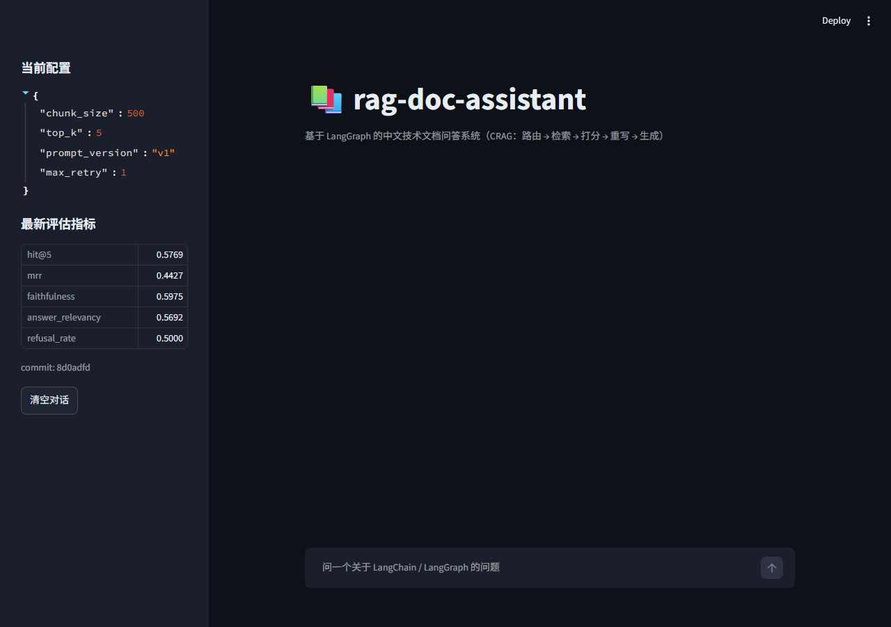
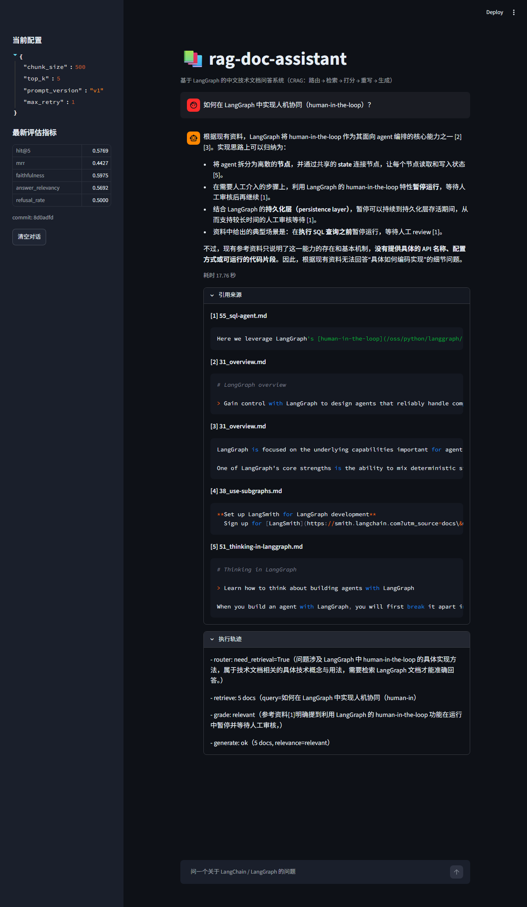

# rag-doc-assistant

基于 LangGraph 的中文技术文档问答系统，**自带 RAG 自动化评估流水线**（CRAG：路由 → 检索 → 相关性打分 → 查询重写 → 生成，循环最多 1 次）。

**仓库**：https://github.com/wjh666629/rag-doc-assistant ｜ **复盘文章**：https://rag-7days-retrospective.app.workbuddy.host/

> 诚实声明：本项目为 7 天从 0 做完的项目（时间线与每日决策见文末 Timeline），开发过程使用 AI 编程助手辅助，AI 工具的使用边界见 [docs/ai_usage.md](docs/ai_usage.md)。

---

## 演示

```bash
python -m src.agent.graph
```

```
你: LangGraph 中如何定义 state？
回答: 根据参考资料 [1]，state 可以定义为 TypedDict、Pydantic 模型或 dataclass...
引用来源:
  [1] 35_use-graph-api.md  ### Define state...
执行路径: router → retrieve(5 docs) → grade(relevant) → generate
```

Streamlit Demo（侧边栏展示当前配置与最新评估指标）：



一次完整问答：带编号引用、引用来源可展开、CRAG 执行轨迹（router → retrieve → grade → generate）：



越界问题实测路径（router → retrieve → grade(irrelevant) → **rewrite** → retrieve → grade(irrelevant) → **拒答**）见 [docs/graph_paths.md](docs/graph_paths.md)。

## 架构

详见 [docs/architecture.mmd](docs/architecture.mmd)（mermaid 源码，GitHub 可直接渲染）。

```
router ─┬─(无需检索)─→ generate ─→ END
        └─(需要检索)─→ retrieve → grade ─┬─(relevant)─→ generate
                                         └─(irrelevant, retry<max)─→ rewrite → retrieve
                                         └─(irrelevant, retry>=max)─→ generate（拒答）
```

5 个节点、2 个条件路由、1 条回边（重写循环由 `max_retry=1` 在代码层硬性封顶）。

## 评估结果（核心章节）

> 所有数字可用一条命令复现：`python -m eval.run_eval --limit 30`
> 报告原文见 `eval/reports/`（每份报告文件名含 git commit 短 hash）。

### 基线指标（baseline）

| 指标 | 值 | 说明 |
|---|---|---|
| Hit@5 | **0.577** | 自研指标，60 条人工校验评估集 |
| MRR | **0.443** | 排序质量 |
| Faithfulness | **0.851** | Ragas（judge temperature=0） |
| Answer Relevancy | **0.778** | Ragas |
| Context Recall | **0.646** | Ragas |
| 越界拒答正确率 | **0.500** | 8 条人工书写越界题（4/8 正确拒答） |
| 平均延迟 | **18.2s**（p95 35.7s） | 含检索与全部 LLM 调用 |

### 对比实验摘要（一次一变量）

| 实验 | 改动 | 关键 Δ | 结论 |
|---|---|---|---|
| E1 | chunk_size 500→300 | 简单事实 Hit@5 持平、MRR -0.08，综合类 0.375→0.25 | **不采纳**：小块降低 embedding 区分度，排名质量与跨块召回双输 |
| E3 | RAG prompt v1→v2 | 拒答正确率持平 0.5 | **不采纳，但有发现**：5/8 越界题被 router 短路为"直接回答"，根本不经 RAG prompt——瓶颈在 router 而非生成措辞 |

### 我们发现

1. **"相似度阈值拒答"不可行**：越界组与正常组的 top1 分数只差 0.11（0.33 vs 0.43），
   阈值不可分——所以拒答依赖 grade 节点的语义判断而非分数阈值；
2. **综合类明显弱于简单事实类**（Hit@5 0.375 vs 0.614）：单次检索对跨文档问题不够；
3. 大代码块切碎会显著污染检索——切分第一原则是"宁可超长，不能切断"。

## 已知缺陷

1. **多跳问题**（需串联 3+ 文档）召回率低——当前是单次检索 + 单次重写，
   下一步：query decomposition；
2. **表格类内容**切分后语义断裂，当前未做特殊处理；
3. **评估集 60 条偏小**，指标波动约 ±0.05，结论只看趋势不看小数点后第二位；
4. 模糊指代问题（"那个东西怎么用？"）目前会走向拒答，理想行为是追问澄清。

## Quickstart

```bash
# 1. 克隆并安装依赖（Windows 11 + Python 3.13 验证过）
pip install -r requirements.txt
# 2. 复制并填写 .env（任意 OpenAI 兼容平台均可：DeepSeek/千问AI/中转）
cp .env.example .env   # 填 DEEPSEEK_API_KEY / DEEPSEEK_BASE_URL / DEEPSEEK_MODEL
# 3. 建库 → 问答 → 评估
python -m src.ingest.build_index --rebuild
python -m src.agent.graph
python -m eval.run_eval --limit 30 --note "my first run"
```

embedding 模型 `BAAI/bge-small-zh-v1.5` 首次运行会自动从 `HF_ENDPOINT` 镜像下载；
如本机网络受限，可先手动下载到 `models/bge-small-zh-v1.5/`（脚本优先加载本地目录）。

## Timeline（7 天时间线与关键决策）

| 天 | 做了什么 | 关键决策 |
|---|---|---|
| D1 | 环境、LLM/Embedding 验证、60 篇语料 | 放弃旧文档地址（整站 301），改从 sitemap 抓新站原生 markdown |
| D2 | 清洗→中文切分→Chroma 入库；LCEL chatbot | 代码块整体不可切分；纯标签噪声行过滤 |
| D3 | 最小 RAG 闭环 + 6 组切分参数实验 | 发现语料与问题不匹配（非语言问题），扩抓 LangGraph 文档 |
| D4 | LangGraph CRAG 改造 + 8 条节点单测 | documents 覆盖式 vs trace 追加式；max_retry 代码级硬上限 |
| D5 | 60 条评估集（16 auto 淘汰 + 16 人工）+ 自研 Hit@5/MRR | 越界组分数只低 0.11 → 阈值拒答不可行，走语义判断 |
| D6 | Ragas 三指标 + 一键评估报告 + Streamlit Demo | 分层抽样修复"limit 截断越界题" |
| D7 | E1/E3 对比实验 + README + 发布自检 | 一次一变量；报告文件名绑定 commit hash |

## 目录结构

```
rag-doc-assistant/
├── configs/default.yaml        # 所有可调参数（chunk/top_k/prompt_version...）
├── data/raw/                   # 60 篇语料（LangChain + LangGraph 官方文档）
├── src/
│   ├── ingest/                 # loader / splitter / build_index（入库管道）
│   ├── agent/                  # state / prompts / nodes / graph（CRAG 图）
│   ├── retriever.py / rag_chain.py / llm.py / app.py
├── eval/
│   ├── golden_qa.json          # 60 条人工校验评估集（核心资产）
│   ├── metrics.py              # 自研 Hit@k / MRR
│   ├── run_eval.py             # 一键完整评估（检索+Ragas+工程指标）
│   └── reports/                # 报告（文件名含 commit hash，可追溯）
├── scripts/                    # Day 1 验证脚本 + fetch_docs / chatbot_lcel 等
├── tests/                      # pytest（节点 + 指标，全绿）
└── docs/                       # pitfalls.md(17 条) / eval_analysis.md / notes/
```

## 技术选型理由

| 选型 | 备选 | 为什么 |
|---|---|---|
| LangGraph (StateGraph) | LCEL / AgentExecutor | 需要"重写后再检索"的循环与条件分支，LCEL 表达循环非常别扭 |
| Chroma | FAISS / Milvus | 零运维、本地持久化、Python 原生，60 篇语料规模足够 |
| BAAI/bge-small-zh-v1.5 | OpenAI text-embedding | 本地免费、中文好、离线可用；CPU 约 25 chunk/s |
| DeepSeek（OpenAI 兼容）| 各家闭源 API | 便宜、中文强、OpenAI 兼容接口可自由切平台 |
| Ragas | 自写 judge prompt | 三指标开箱即用；版本坑见 docs/pitfalls.md 坑 14 |
| pytest + MOCK_LLM | 全真实 API 测试 | 单测不烧钱，CI 自检可复现 |
